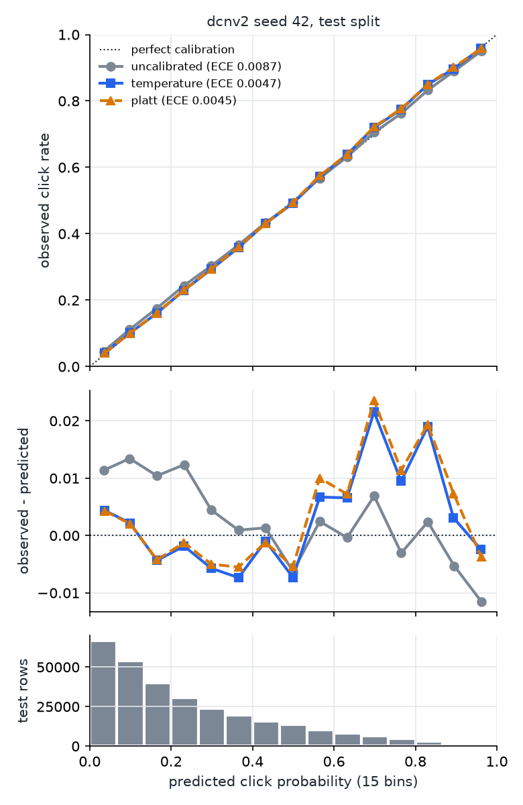

# 🎯 CTR Prediction + Neural Contextual Bandits (PyTorch, Criteo)

Two connected problems from online advertising, on public data, with every model written by hand.
First, predict the probability that a user clicks an ad: four click-through-rate (CTR) models are
trained on 3M rows of the Criteo Display Advertising Challenge data and compared on ranking,
probability quality and calibration. Second, the best calibrated model becomes a simulated user
that a **contextual bandit** must learn to serve, choosing which ad to show from clicks alone.

---

## 🚀 Features

- 🧠 Four CTR models implemented from scratch in **PyTorch**: logistic regression, Factorization
  Machine, **DeepFM** and **DCN-v2** (no CTR library)
- 🧮 Preprocessing for large sparse tabular data: hashing trick into one shared embedding table,
  rare-value and missing-value ids, time-ordered split with no future leakage
- 📊 Evaluation by AUC and LogLoss, **ablations** changing one setting at a time, std over seeds
- 🎚️ **Calibration**: expected calibration error, reliability diagrams, temperature and Platt scaling
- 🎰 Semi-synthetic **contextual bandit** built on the best model, and five policies: random,
  epsilon-greedy, **LinUCB**, **Linear Thompson Sampling** and **NeuralLinear** Thompson Sampling
- 🔬 Diagnostic scripts that explain the results (why 20k rounds are too few, why NeuralLinear loses)
- ✅ 49 unit tests (FM trick vs double loop, cross layer identity, posterior closed form, ...)

---

## ⚙️ How it works

```
Criteo train.txt ──► first 3M rows ──► log1p + missing flags | rare ids + hashing (2^20)
                 ──► split by row order 80/10/10 ──► LR / FM / DeepFM / DCN-v2 ──► AUC, LogLoss
                 ──► best model ──► Platt scaling (fitted on validation) ──► calibrated p(click)

bandit round:  test row (user) ──► policy sees 32 PCA features of DeepFM embeddings
               ──► picks one of 10 ads (values of field C6) ──► click ~ Bernoulli(p from DCN-v2)
               ──► regret = best ad's p - chosen ad's p
```

| Component | Choice |
|---|---|
| Data | Criteo Display Advertising Challenge, first 3M rows (13 numeric, 26 categorical features, CTR 0.25) |
| Categorical features | values seen < 10 times in train -> one "rare" id per field; others hashed into one 2^20-row table |
| Embeddings | 52 fields x 16 dims, shared by FM, DeepFM and DCN-v2 (comparisons isolate the architecture) |
| DCN-v2 | 2 full-rank cross layers `x0 * (W x + b) + x`, then MLP 832 -> 256 -> 128 |
| Training | Adam, lr 1e-3, batch 4096, early stopping on validation LogLoss |
| Bandit oracle | Platt-calibrated DCN-v2 with field C6 set to the chosen ad |
| Policy features | a different model (DeepFM): 32 whitened PCA components, the ad's field removed |
| NeuralLinear | MLP 33 -> 64 -> 32, retrained every 1,000 rounds, Bayesian linear regression per ad on top |

---

## 📊 Results

Every number below is produced by a script in this repository.

### CTR models (test set, 300k rows)

| Model | Test AUC | Test LogLoss | Parameters |
|---|---|---|---|
| Logistic regression | 0.78725 | 0.45864 | 1.0M |
| Factorization Machine | 0.78879 | 0.45829 | 17.8M |
| DeepFM | 0.79330 | 0.45463 | 18.1M |
| **DCN-v2** | **0.79514** | **0.45259** | 18.4M |

DCN-v2 over 3 seeds: test AUC **0.79492 ± 0.00026**. All embedding models reach their best
validation loss at epoch 2 and overfit afterwards.

### DCN-v2 ablations


| Change from the default (k=16, 2 cross layers, 2^20 hash) | Test AUC | Parameters |
|---|---|---|
| default | 0.79514 | 18.4M |
| embedding dim 16 -> 8 | 0.79458 | 8.9M |
| cross layers 2 -> 1 | 0.79444 | 17.7M |
| cross layers 2 -> 3 | 0.79515 | 19.1M |
| hash size 2^20 -> 2^18 | 0.79498 | **5.8M** |

### Calibration (DCN-v2, 3 seeds)



| | Test ECE | Test LogLoss | Test AUC |
|---|---|---|---|
| uncalibrated | 0.00724 ± 0.00326 | 0.45259 | 0.79492 |
| temperature scaling | 0.00516 ± 0.00147 | 0.45222 | 0.79492 |
| **Platt scaling** | **0.00413 ± 0.00037** | 0.45218 | 0.79492 |

### Contextual bandit (100k rounds, 10 ads, 5 seeds)


| Policy | Cumulative regret | Per round |
|---|---|---|
| random | 4417 ± 10 | 0.0442 |
| NeuralLinear TS | 3562 ± 131 | 0.0356 |
| epsilon-greedy (eps 0.05) | 2697 ± 155 | 0.0270 |
| Linear TS | 2428 ± 171 | 0.0243 |
| *best fixed ad, chosen in hindsight* | *2364 ± 2* | *0.0236* |
| **LinUCB (alpha 0.1)** | **1959 ± 91** | **0.0196** |

**Metrics.** AUC: probability that a clicked row is scored above a non-clicked one (ranking only).
LogLoss: the training objective, punishes wrong probabilities. ECE: average gap between predicted
and observed click rate over 15 bins. Regret: clicks lost against an oracle that always shows the
best ad for each user (lower is better). Hyperparameters (LinUCB alpha, epsilon) are tuned on a
separate seed, never on the 5 reported ones.

### What the results show

- **Explicit crosses help:** DCN-v2 beats DeepFM by 0.0018 AUC, about 7 seed standard deviations;
  the second cross layer matters (+0.0007), a third adds nothing.
- **The hash table can shrink 3x for free:** 2^18 rows cost 0.0002 AUC, within noise, because only
  ~128k categorical values appear 10+ times in train.
- **Calibration without losing ranking:** Platt scaling cuts test ECE by 43% and AUC is unchanged by
  construction; it also fixes the global under-prediction that a single temperature cannot.
- **LinUCB is the only policy that beats the best fixed ad** (by 17%); its regret per round keeps
  falling (0.0295 in the first quarter, 0.0149 in the last).

### Diagnostics

Two results needed an explanation before being reported:

- **Clicks are a low signal-to-noise reward** (`scripts/bandit_difficulty.py`). At 20k rounds no
  policy beat the best fixed ad. The features were fine: a linear model fitted on the true
  probabilities picks ads with regret 47 vs 462 for the fixed ad. The noise was not: the same model
  fitted on 2,000 noisy clicks per ad has regret 515. LinUCB overtakes the fixed ad around 100k
  rounds, hence the horizon.
- **NeuralLinear loses for a reason, not a bug** (`scripts/neural_linear_diagnostic.py`). Only 1.5%
  of the variance of the true click probability depends on which ad is shown; the rest is the user.
  An MLP trained on clicks spends its representation on the user part: with the same Bayesian layer,
  greedy play gives regret 589 on the learned features vs 328 on the raw ones. On a toy problem
  where the ad effect is the whole signal, NeuralLinear wins (212 vs 486 for LinUCB).

---

## 🗂️ Project Structure

```
├── src/ctr/
│   ├── config.py           # paths, seeds, sample size, hash size, field names
│   ├── data.py             # streaming read, log1p + flags, rare ids, hashing, split, DataLoader
│   ├── models/             # logreg.py, fm.py, deepfm.py, dcnv2.py
│   ├── train.py            # shared training loop, early stopping, metrics.csv
│   ├── metrics.py          # AUC, LogLoss, mean prediction vs CTR
│   └── calibrate.py        # ECE, reliability diagram, temperature and Platt scaling
├── src/bandit/
│   ├── simulator.py        # semi-synthetic environment built on the CTR models
│   ├── policies.py         # random, eps-greedy, LinUCB, Linear TS, NeuralLinear TS
│   └── run.py              # tune on seed 0, evaluate on seeds 1-5
├── scripts/                # data sampling, ablations, plots, diagnostics
├── results/                # metrics, ablation, calibration and regret CSVs + figures
└── tests/                  # pytest unit tests
```

---

## 🛠️ Setup

Requires Python 3.12. CPU only, no API key. The data is downloaded from Criteo's public release
(not redistributed here); check Criteo's terms of use before using it.

```powershell
python -m venv .venv
.\.venv\Scripts\python.exe -m pip install -r requirements.txt
$env:PYTHONPATH="src"
.\.venv\Scripts\python.exe scripts/sample.py --rows 3000000   # stream 3M rows (~2 min)
.\.venv\Scripts\python.exe -m ctr.data                         # preprocess + split
```

**Train and evaluate the CTR models** (about 30 minutes on CPU, ablations about 1 hour more)

```powershell
foreach ($m in "logreg", "fm", "deepfm", "dcnv2") { .\.venv\Scripts\python.exe -m ctr.train --model $m }
.\.venv\Scripts\python.exe scripts/ablate.py --model dcnv2
.\.venv\Scripts\python.exe -m ctr.calibrate
```

**Run the bandit experiment** (about 15 minutes)

```powershell
.\.venv\Scripts\python.exe -m bandit.run
.\.venv\Scripts\python.exe scripts/plot_regret.py
.\.venv\Scripts\python.exe scripts/neural_linear_diagnostic.py
```

**Run the tests**

```powershell
.\.venv\Scripts\python.exe -m pytest -q
```

Each command prints a summary and writes its table or figure to `results/`. For a quick check
of the whole pipeline, use `--rows 300000`, `--epochs 1`, `ctr.calibrate --seeds 42` and
`bandit.run --horizon 5000`; numbers from such a short run are not meaningful.

---

## ⚠️ Limitations

- **Simulated users:** the bandit's clicks come from DCN-v2, so a policy is rewarded for matching
  the model, not real behaviour.
- **Anonymized features:** Criteo hides what each field means, so "field C6 = the ad" is an
  assumption; setting C6 to a value a row never had asks the model to extrapolate (the 10 chosen
  values cover 89% of train rows).
- **One sample, one split:** 3M of the 45M rows; DCN-v2 has 3 seeds, the other models 1.
- **Unequal tuning:** LinUCB and epsilon-greedy have a tuned exploration knob, the Thompson policies
  do not, so they may explore more than necessary.
- **NeuralLinear as in the paper:** keeping the raw features next to the learned ones is the natural
  next experiment.

---

## 📚 References

Rendle 2010 (Factorization Machines) · Guo et al. 2017 (DeepFM) · Wang et al. 2021 (DCN V2) ·
Guo et al. 2017 (On Calibration of Modern Neural Networks) · Li et al. 2010 (LinUCB) ·
Riquelme, Tucker, Snoek 2018 (Deep Bayesian Bandits Showdown, NeuralLinear)

---

## 📄 License

Released under the [MIT License](LICENSE).
