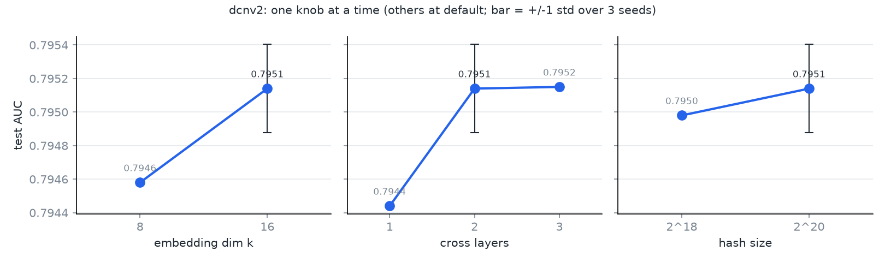
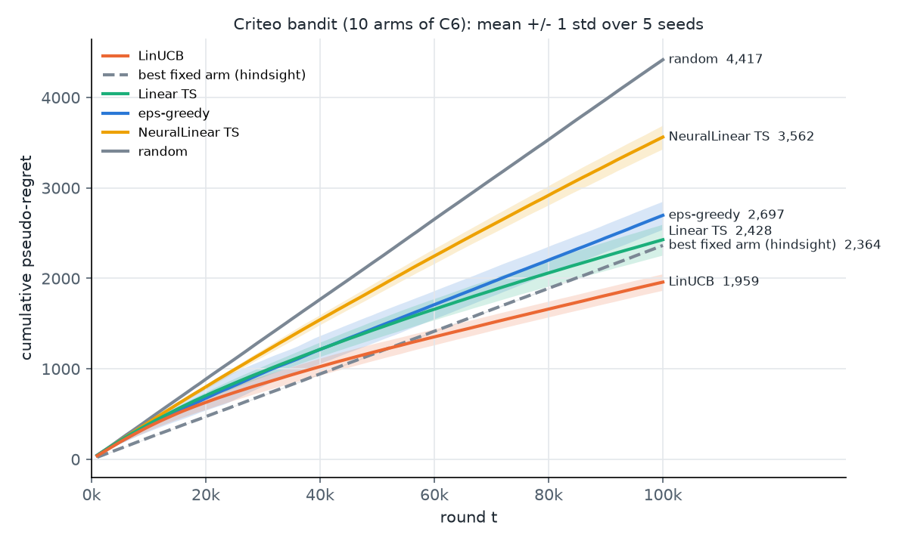

# 🎯 CTR Prediction + Contextual Bandits on Criteo

CTR models written from scratch in PyTorch (LR, FM, DeepFM, DCN-v2) on 3M rows of the Criteo
Display Advertising data. The best one is calibrated and then used as a simulated user to compare
bandit policies that learn which ad to show.

---

## 🚀 Features

- CTR models from scratch in PyTorch: logistic regression, FM, DeepFM, DCN-v2
- Hashing trick, rare/missing ids, time-ordered train/val/test split
- AUC, LogLoss, ablations, calibration (ECE, temperature and Platt scaling)
- Bandit simulator built on the calibrated model
- Policies: random, epsilon-greedy, LinUCB, Linear Thompson Sampling, NeuralLinear
- 49 unit tests

---

## ⚙️ How it works

```
Criteo rows ──► preprocessing ──► LR / FM / DeepFM / DCN-v2 ──► Platt scaling ──► p(click)

each round: user (test row) ──► policy picks 1 of 10 ads ──► click ~ Bernoulli(p) ──► regret
```

The "ads" are the 10 most frequent values of field C6. Policies don't see the true model: they
get 32 PCA features from DeepFM embeddings.

---

## 📊 Results

**CTR models** (test set, 300k rows)

| Model | AUC | LogLoss |
|---|---|---|
| Logistic regression | 0.7873 | 0.4586 |
| FM | 0.7888 | 0.4583 |
| DeepFM | 0.7933 | 0.4546 |
| **DCN-v2** | **0.7951** | **0.4526** |

DCN-v2 over 3 seeds: 0.7949 ± 0.0003 AUC. Ablations: a second cross layer helps, a third doesn't,
and shrinking the hash table from 2^20 to 2^18 (3x fewer parameters) costs nothing measurable.
Platt scaling reduces calibration error (ECE) from 0.0072 to 0.0041 without changing AUC.



**Bandits** (100k rounds, 5 seeds, lower is better)

| Policy | Cumulative regret |
|---|---|
| random | 4417 |
| NeuralLinear | 3562 |
| epsilon-greedy | 2697 |
| Linear TS | 2428 |
| *best single ad (hindsight)* | *2364* |
| **LinUCB** | **1959** |



Two things worth noting:

- Clicks are very noisy, so a contextual policy needs a lot of rounds: at 20k rounds none of them
  beat the best single ad. LinUCB gets there around 100k (`scripts/bandit_difficulty.py`).
- NeuralLinear does worse than the linear policies here. Only ~1.5% of the click-probability
  variance depends on the ad, so the network learns "who clicks" rather than "which ad"
  (`scripts/neural_linear_diagnostic.py`). On a toy problem with a strong ad effect it wins.

---

## 🗂️ Project Structure

```
├── src/ctr/       # data, models, training loop, metrics, calibration
├── src/bandit/    # simulator, policies, experiment runner
├── scripts/       # sampling, ablations, plots, diagnostics
├── results/       # CSV results and figures
└── tests/
```

---

## 🛠️ Setup

Python 3.12, CPU only. The data is downloaded from Criteo's public release (not included here).

```powershell
python -m venv .venv
.\.venv\Scripts\python.exe -m pip install -r requirements.txt
$env:PYTHONPATH="src"

.\.venv\Scripts\python.exe scripts/sample.py --rows 3000000
.\.venv\Scripts\python.exe -m ctr.data
foreach ($m in "logreg", "fm", "deepfm", "dcnv2") { .\.venv\Scripts\python.exe -m ctr.train --model $m }
.\.venv\Scripts\python.exe -m ctr.calibrate
.\.venv\Scripts\python.exe -m bandit.run
.\.venv\Scripts\python.exe scripts/plot_regret.py
.\.venv\Scripts\python.exe -m pytest -q
```

Training takes about 30 minutes on CPU, the bandit runs about 15.

---

## ⚠️ Limitations

- The simulated users are a model, not real people.
- Criteo features are anonymized, so treating C6 as "the ad" is an assumption.
- One 3M-row sample out of 45M; only DCN-v2 was run on several seeds.
- LinUCB's exploration was tuned, the Thompson policies weren't.

---

## 📄 License

[MIT](LICENSE)
